# Telas do Clube Auto

Proposta visual das telas do app, feita a partir do front-end atual. Serve como referência para o front-end e
para o backend saberem o que cada tela mostra e quais dados precisa receber.

> Os valores (preços, nomes, notas, quantidades) são exemplos para o desenho, não dados reais.

## Como ver e alterar

| Pasta | O que tem | Para quê |
| --- | --- | --- |
| `png/` | Uma imagem por tela | Ver rápido, inclusive pelo GitHub |
| `prototipo/` | HTML puro, um arquivo por tela | Abrir `prototipo/index.html` no navegador e clicar entre as telas. **Para alterar uma tela, edite o HTML daqui.** |
| `canvas/` | Fonte original do canvas de design (`.dc.html` + `canvas.json`) | Só abre dentro do canvas de design. Fica como arquivo de origem; não precisa mexer |

Depois de alterar um HTML do `prototipo/`, a imagem em `png/` fica desatualizada até ser gerada de novo.

## Identidade visual

- Cores: asfalto `#131315`, grafite `#1C1C1F`, amarelo de sinalização `#FFC800`, papel `#F2EFE8`,
  laranja de alerta `#FF8A3D`, verde de sucesso `#43D17A`, vermelho de erro `#FF5A4F`.
- Letras: Barlow Condensed nos títulos e preços, Barlow no texto.
- A oferta tem forma de ticket com picote; a oferta relâmpago é o ticket amarelo.
- Ícone: `public/brand/` (versão completa e versão simplificada para tamanhos pequenos).

## Telas

Legenda: **existe** = já está no app hoje · **nova** = proposta, ainda não implementada.

### Marca

| | Tela | Situação | O que faz |
| --- | --- | --- | --- |
| 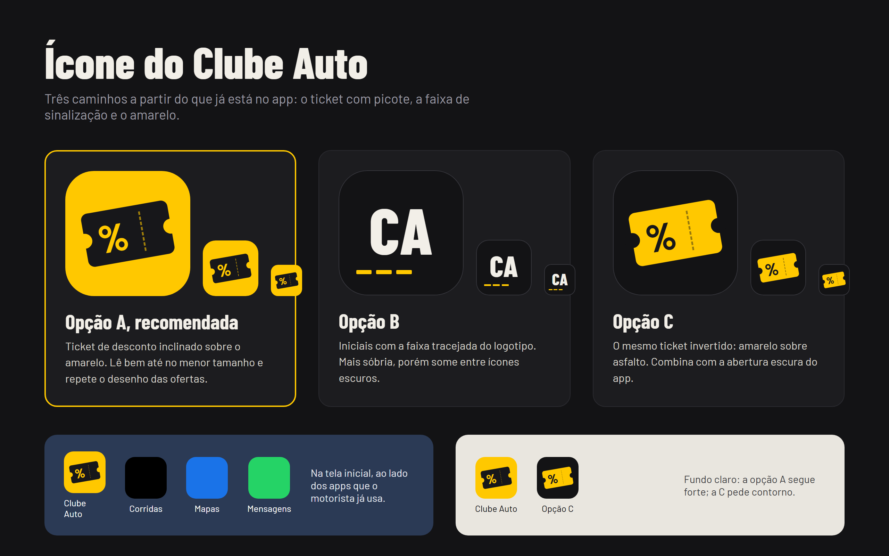 | Ícone | — | Três opções de ícone. A escolhida virou o arquivo em `public/brand/`. |
| 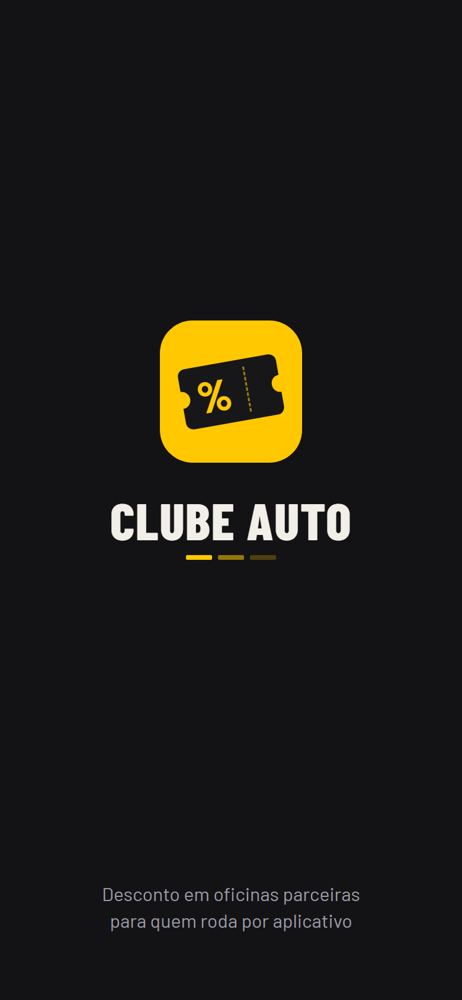 | Abertura | nova | Aparece enquanto o app carrega a sessão. Com login salvo, vai direto para Ofertas ou para o Painel. |

### Acesso e cadastro

| | Tela | Situação | O que faz | Precisa do backend |
| --- | --- | --- | --- | --- |
| 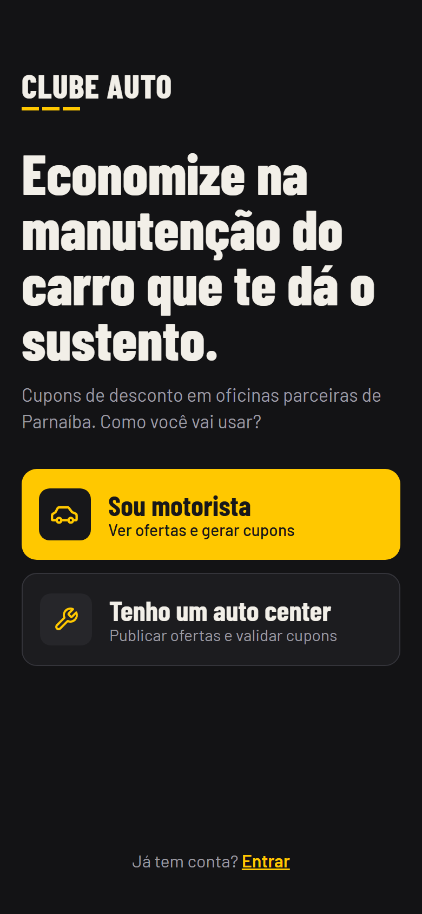 | Boas-vindas | existe (provisória) | Escolhe o tipo de conta: motorista ou auto center. | — |
| 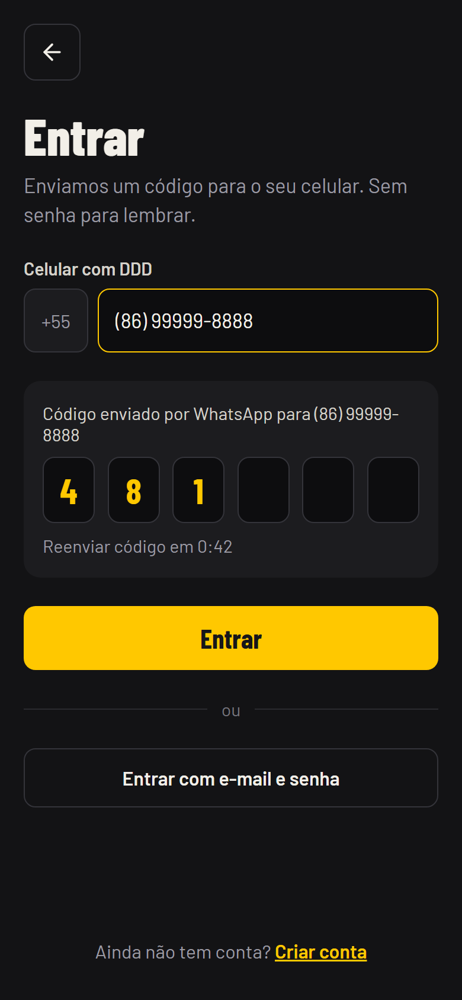 | Entrar | nova | Login pelo celular com código por WhatsApp/SMS; e-mail e senha como alternativa. | Envio e verificação do código; sessão; tipo de conta (`driver`/`partner`) para decidir a rota |
| 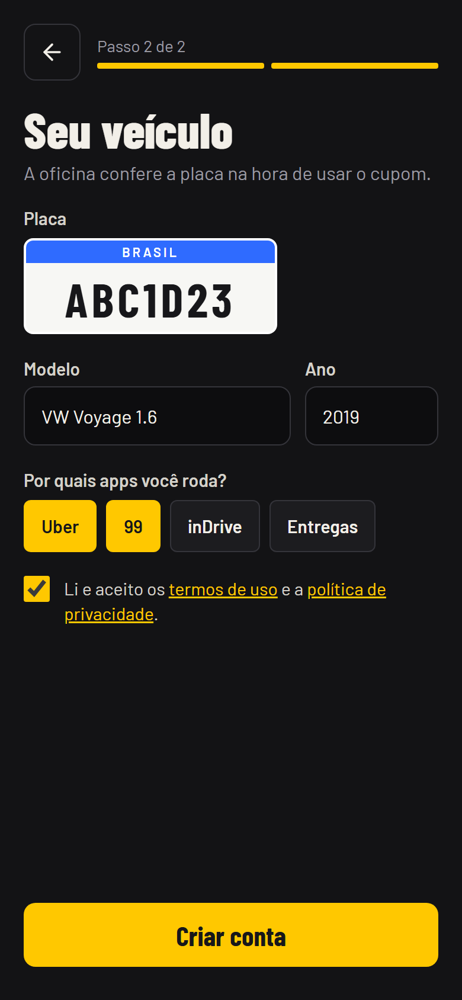 | Cadastro do motorista | nova | 2 passos: dados pessoais e veículo (placa Mercosul ou antiga, modelo, ano, apps em que roda). Aceite de termos (LGPD). | Criar usuário e veículo; validar placa; registrar aceite dos termos com data |
| 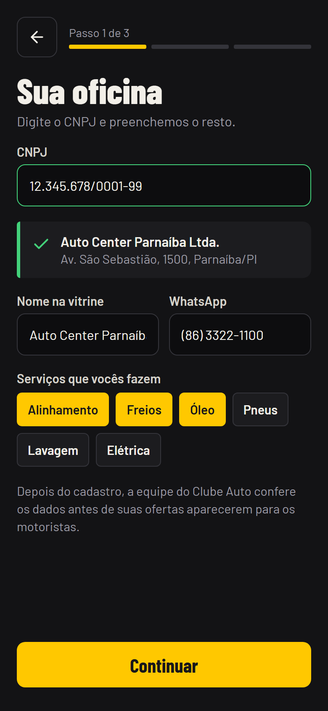 | Cadastro do auto center | nova | CNPJ preenche nome e endereço; nome de vitrine, WhatsApp, serviços. Conta fica em análise. | Consulta de CNPJ; status da conta (em análise / aprovada); serviços oferecidos |

### Motorista

| | Tela | Situação | O que faz | Precisa do backend |
| --- | --- | --- | --- | --- |
| 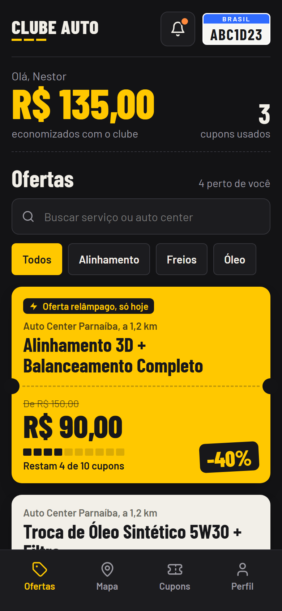 | Ofertas (início) | existe | Economia acumulada, busca, filtro por categoria, ofertas em ticket. Proposta: barra de abas embaixo no lugar do menu lateral. | Lista de ofertas com estoque; distância até a oficina; total economizado; categorias (inclui **Freios**, que hoje não existe) |
| 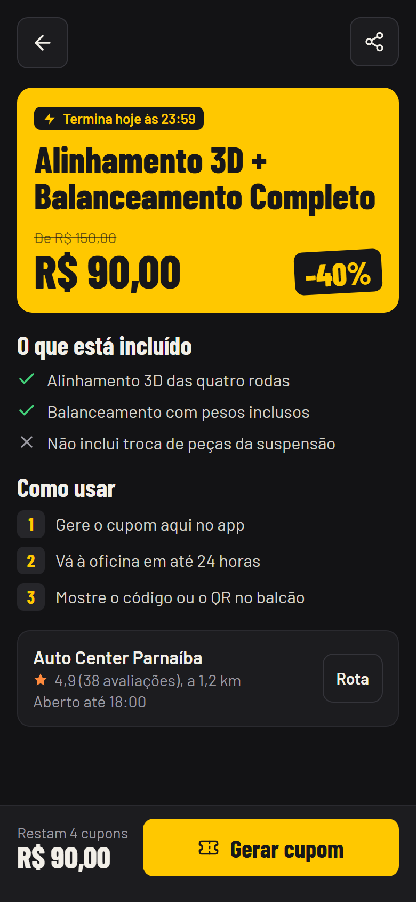 | Detalhe da oferta | nova | O que está incluído, como usar, nota e distância da oficina; só então gera o cupom. | Descrição e itens inclusos da oferta; nota média e nº de avaliações da oficina; horário de funcionamento |
| 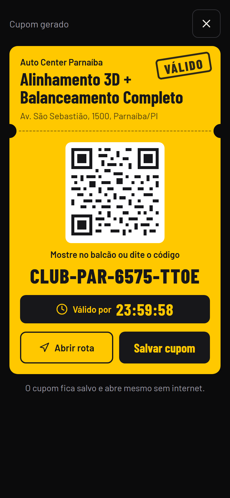 | Cupom gerado | existe | Ticket com código, **QR code**, prazo e rota no GPS. Abre sem internet. | Gerar código e QR **no servidor**; prazo de validade; baixar estoque no servidor |
| 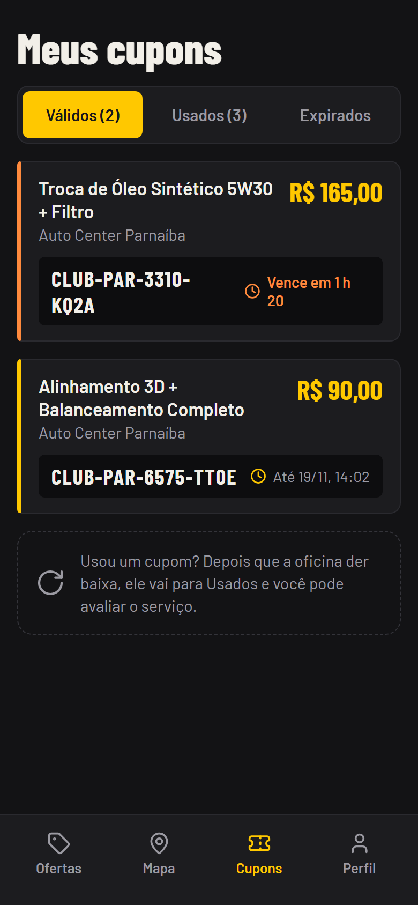 | Meus cupons | existe | Válidos, usados e expirados. Cupom perto de vencer fica laranja. | Lista de cupons do motorista com status (`valid`/`used`/`expired`) decidido pelo servidor |
| 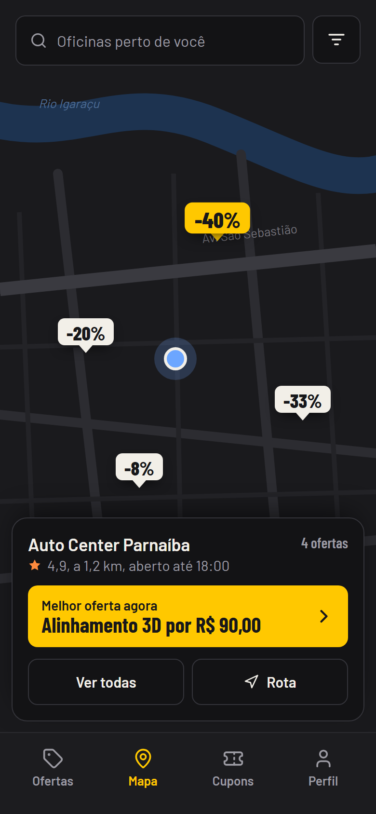 | Mapa de oficinas | nova | Oficinas próximas com o maior desconto de cada uma. | Coordenadas das oficinas; busca por proximidade |
| 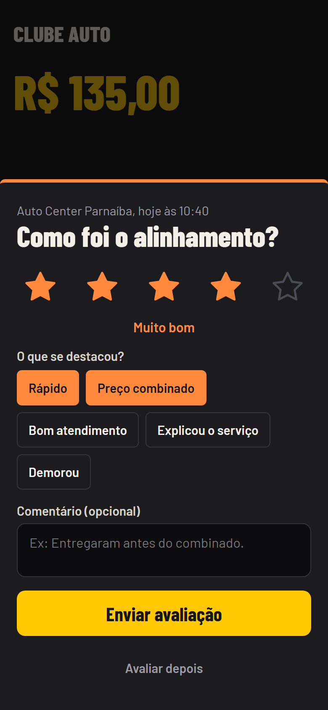 | Avaliar serviço | existe | Estrelas, etiquetas rápidas e comentário. | Salvar avaliação ligada ao cupom; etiquetas |
| 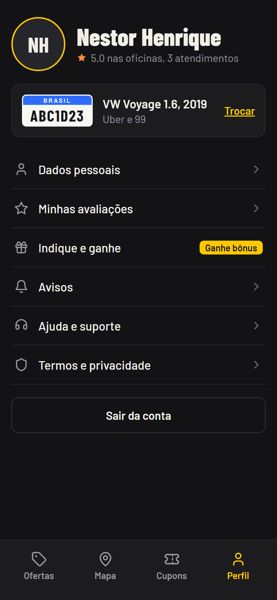 | Perfil e veículo | existe | Nota do motorista, veículo, menu da conta, sair. | Nota do motorista; mais de um veículo por conta (sugestão) |
| 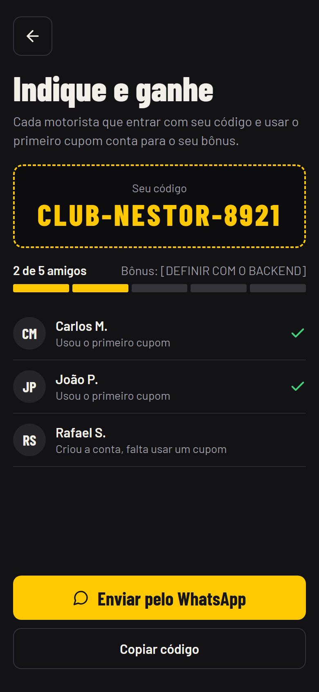 | Indique e ganhe | existe | Código de indicação, progresso e amigos que entraram. | Código único por usuário (hoje é fixo no front); **regra do bônus a definir** |
| 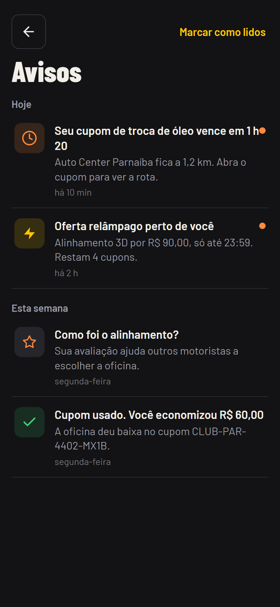 | Avisos | nova | Cupom vencendo, oferta relâmpago perto, avaliação pendente, cupom usado. | Notificações (push no app Flutter, notificação do navegador no web) |
| 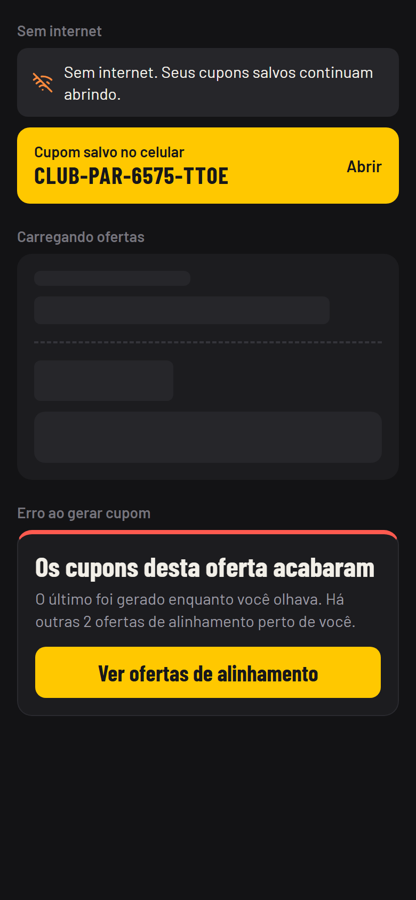 | Sem internet e erros | nova | Cupom salvo abre offline; carregamento; erro com saída clara. | Mensagens de erro com motivo (ex.: estoque esgotado) |

### Auto center

| | Tela | Situação | O que faz | Precisa do backend |
| --- | --- | --- | --- | --- |
| 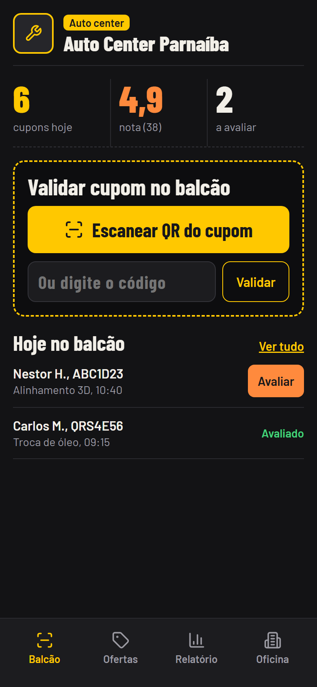 | Painel (balcão) | existe | Números do dia, escanear QR ou digitar código, atendimentos de hoje. | Validar cupom **no servidor**; números reais do dia (hoje "28 baixas no mês" é fixo) |
| 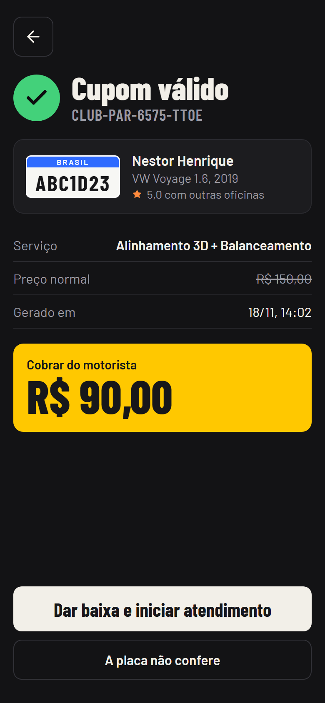 | Cupom validado | nova | Mostra motorista, placa, carro e valor a cobrar antes de dar baixa. | Dados do cupom + motorista + veículo; registrar a baixa |
| 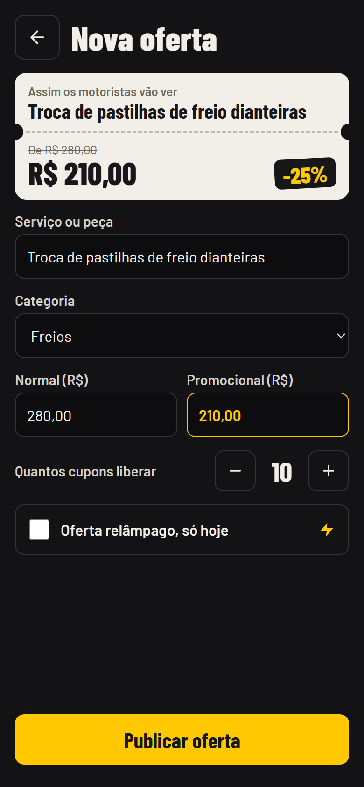 | Nova oferta | existe | Cadastro com prévia ao vivo do ticket, limite de cupons, oferta relâmpago. | Criar oferta; importação de planilha (hoje só mostra aviso) |
| 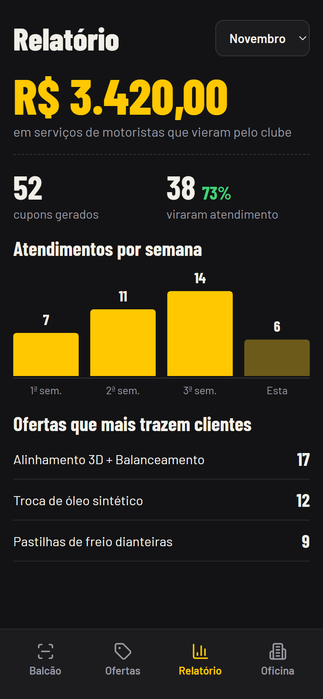 | Relatório do mês | nova | Valor trazido pelo clube, cupons gerados x usados, ofertas que mais trazem clientes. | Agregados por mês e por semana |

## Regras que hoje estão no front e precisam ir para o servidor

- Geração do código do cupom (`src/lib/coupon.ts` usa `Math.random`).
- Validação do cupom no balcão (hoje só confere se começa com `CLUB-PAR-`).
- Baixa de estoque ao gerar cupom.
- Expiração do cupom.
- Código de indicação (hoje termina sempre em `8921`).
